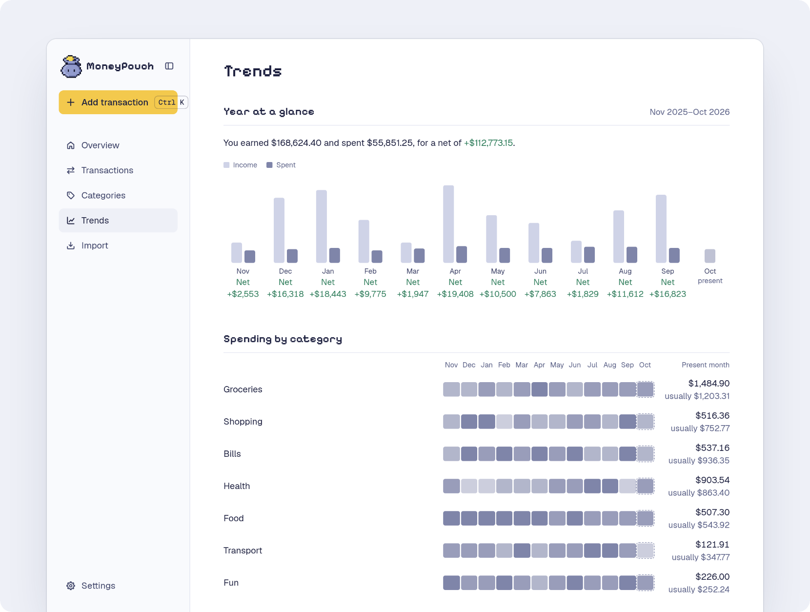
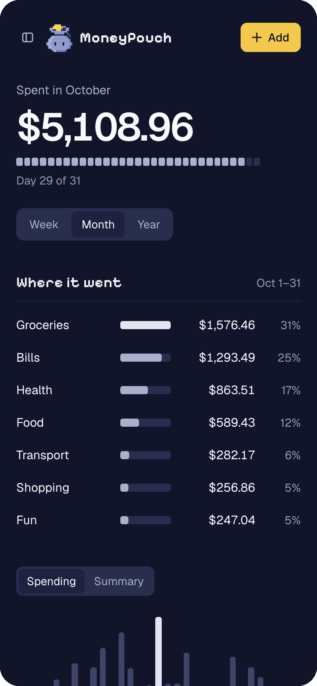

<h1 align="center"><br>MoneyPouch</h1>

<p align="center">No budgets. No net worth. Just see where your money goes.<br>Log an expense in a few seconds, on your own server, for free.</p>

<p align="center">
  <a href="#getting-started">Getting started</a> ·
  <a href="https://github.com/kenyounot123/moneypouch/releases">Releases</a> ·
  <a href="CHANGELOG.md">Changelog</a> ·
  <a href="https://github.com/kenyounot123/moneypouch/issues">Issues</a>
</p>

<p align="center">
  <a href="https://github.com/kenyounot123/moneypouch/releases"></a>
  <a href="https://github.com/kenyounot123/moneypouch/actions/workflows/ci.yml"></a>
  <a href="https://github.com/kenyounot123/moneypouch/pkgs/container/moneypouch"></a>
</p>

<p align="center">
  
</p>

<table>
  <tr>
    <td width="40%"></td>
    <td width="40%"></td>
    <td width="20%"></td>
  </tr>
  <tr>
    <td align="center">Where it went this month</td>
    <td align="center">A year at a glance</td>
    <td align="center">On your phone</td>
  </tr>
</table>

Try it with one command, then open [localhost:8080](http://localhost:8080). [Getting started](#getting-started) has the details.

```bash
docker run -d --name moneypouch --restart unless-stopped -p 8080:80 -v moneypouch-data:/rails/storage ghcr.io/kenyounot123/moneypouch:latest
```

I built MoneyPouch because every app I tried wanted me to budget first, and I only wanted to know where my money went. [The longer story](#why-i-built-moneypouch).

## Contents

| To | Read |
| :--- | :--- |
| Decide if MoneyPouch is for you | [Features](#features) · [What MoneyPouch is not](#what-moneypouch-is-not) · [How it compares](#how-it-compares) · [Why I built MoneyPouch](#why-i-built-moneypouch) |
| Install it | [System requirements](#system-requirements) · [Getting started](#getting-started) |
| Log your spending | [Type it like you'd say it](#type-it-like-youd-say-it) · [Bank sync with SimpleFIN](#bank-sync-with-simplefin) |
| Run the server | [Share your server with friends](#share-your-server-with-friends) · [Forgot your password](#forgot-your-password) · [Backups and updates](#backups-and-updates) |
| Help build it | [Contributing](#contributing) |

## Features
- **Fast entry.** Press ⌘K (Ctrl+K), type `Chipotle 11.25 yesterday`, and press Enter.
- **It remembers.** Tab completes names you have used, and their category comes back.
- **Your data, your server.** One command starts it. Your data is in SQLite files in a volume you own.
- **Bring your history.** Import an Excel or CSV file. Rows you already have are skipped, and you can undo the whole import.
- **Take it with you.** Download every transaction as a CSV file, any time.
- **Bank sync, optional.** Connect your own SimpleFIN account to pull in transactions from your bank accounts.

## What MoneyPouch is not

MoneyPouch is not a budgeting app. It has no envelopes, no "give every dollar a job", no net worth, and no investment tracking. Those features are good for some people, but most of us only want to know where the money went. MoneyPouch does that one job and stays fast.

## How it compares

| | Free | Runs on your server | Time to log a purchase | Bank sync |
|---|---|---|---|---|
| **MoneyPouch** | ✅ | ✅ | ✅ ~3 sec - `Chipotle 11.25 yesterday #food` | ✅ Optional |
| [YNAB](https://www.ynab.com) | ❌ $109/year | ❌ | Minutes - budget it, then categorize it | ✅ |
| [Monarch](https://www.monarchmoney.com) | ❌ $99.99/year | ❌ | Minutes - review and categorize the sync | ✅ |
| [Copilot](https://copilot.money) | ❌ $95/year | ❌ | Auto-import, then fix the categories | ✅ |
| [Actual Budget](https://actualbudget.org) | ✅ | ✅ | Assign it to an envelope first | ✅ Optional |
| [Firefly III](https://www.firefly-iii.org) | ✅ | ✅ | Set up double-entry rules | ✅ Optional |

Bank sync in MoneyPouch uses your own SimpleFIN account. Prices are for yearly plans as of October 2026. If you want a budget, Actual Budget is a good free choice. If you want real accounting, use Firefly III.

## System requirements

MoneyPouch is light. The image is built for 64-bit x86 and ARM, so an old PC or a Raspberry Pi 4 or later has enough power to run it.

|      | Minimum | Recommended |
| ---- | ------- | ----------- |
| RAM  | 512 MB free | 1 GB free |
| CPU  | Any 64-bit x86 or ARM CPU | 2 cores |
| Disk | 2 GB free | 2 GB free |

Your data takes almost no space. Ten years of spending, 30,000 transactions, is about 5 MB.

These numbers come from running the Docker image with Docker's memory and CPU limits and loading pages as a user with 30,000 transactions. MoneyPouch used about 300 MB of memory and stopped working at a 256 MB limit. With a quarter of one CPU core, pages still loaded in about 0.1 to 0.2 seconds.

## Getting started

MoneyPouch runs in Docker on Windows, macOS, and Linux. You install Docker once, then start MoneyPouch with one command.

### 1. Install Docker

| Your computer | What to install |
| :--- | :--- |
| Windows 10 or 11 | [Docker Desktop for Windows](https://docs.docker.com/desktop/setup/install/windows-install/) |
| macOS | [Docker Desktop for Mac](https://docs.docker.com/desktop/setup/install/mac-install/) |
| Linux, including a Raspberry Pi | [Docker Engine](https://docs.docker.com/engine/install/) |

If you use Docker Desktop, open it and wait until it shows that Docker is running.

### 2. Start MoneyPouch

Open a terminal. On Windows, use PowerShell or Command Prompt. On macOS, use the Terminal app. Paste this command and press Enter:

```bash
docker run -d --name moneypouch --restart unless-stopped -p 8080:80 -v moneypouch-data:/rails/storage ghcr.io/kenyounot123/moneypouch:latest
```

The command is the same in every terminal. The first time, Docker downloads about 250 MB. After that, MoneyPouch is ready in about 2 seconds.

### 3. Open MoneyPouch

Go to [localhost:8080](http://localhost:8080) in your browser and create your account. The first account is the owner, and registration closes after it. To give friends their own accounts, see [Share your server with friends](#share-your-server-with-friends).

MoneyPouch starts again by itself when your computer or Docker restarts. To use a port other than 8080, change the first `8080` in the command. Your data and the app's secret key are in the Docker volume `moneypouch-data`. See [Backups and updates](#backups-and-updates).

### Other ways to install

**ONCE.** Use [ONCE](https://github.com/basecamp/once) on a Linux or macOS server that you want to reach by a domain name. ONCE sets up HTTPS for the domain, backs up your data daily, keeps 30 days of backups, and installs updates.

1. Install ONCE.

   ```bash
   curl https://get.once.com | sh
   ```

2. In the ONCE dashboard, choose to install from a Docker image.
3. Enter the image `ghcr.io/kenyounot123/moneypouch:latest`.
4. Enter a hostname. `moneypouch.localhost` works on this machine only.

**Docker Compose.** Use Compose if you prefer a file, or if your NAS or Portainer asks for one. Save this as `compose.yaml` in an empty folder, and run `docker compose up -d` in that folder. It uses the same container and volume names as the `docker run` command, so every command below works for both.

```yaml
services:
  app:
    image: ghcr.io/kenyounot123/moneypouch:latest
    container_name: moneypouch
    restart: unless-stopped
    ports:
      - "8080:80"
    volumes:
      - moneypouch-data:/rails/storage

volumes:
  moneypouch-data:
    name: moneypouch-data
```

### First steps

1. Create your account.
2. Press ⌘K (Ctrl+K), type `Coffee 4.50`, and press Enter. That's your first expense.
3. Optional: connect your bank in Settings. See [Bank sync with SimpleFIN](#bank-sync-with-simplefin).

## Type it like you'd say it

<p align="center">
  
</p>

| | You type | MoneyPouch reads |
| :--- | :--- | :--- |
| **Amount** | `6.25` `$6.25` `1,650` | this is an expense/spending |
| **Money in** | `+2000` | income, not spending |
| **Date** | `yesterday` `sep 26` `friday` | that day, or today if left out |
| **Category** | `#food` | food, or if left out, the category you last used for that name |

## Bank sync with SimpleFIN

Bank sync is optional. When you turn it on, MoneyPouch reads your transactions through [SimpleFIN](https://www.simplefin.org/), an open protocol for sharing read-only financial data with apps. Whether to give an app access to your bank data is your call. Here are some reasons it can be okay:

1. **Read-only.** The [protocol](https://www.simplefin.org/protocol.html) has no way to move money. MoneyPouch can see your accounts, balances, and transactions, and that's all.
2. **Your bank login never reaches MoneyPouch.** You add your bank on the [SimpleFIN Bridge](https://beta-bridge.simplefin.org/), not in MoneyPouch. The Bridge hands bank connections to [MX](https://www.mx.com/) and says bank credentials never touch its own servers ([security](https://beta-bridge.simplefin.org/info/security)).
3. **One-time tokens.** You paste a setup token into MoneyPouch, which trades it for a private access URL. Once MoneyPouch claims it, the token stops working and can't be used again.
4. **Stored encrypted, on your server.** MoneyPouch encrypts the access URL in your own database. The key is in the same volume, so this protects a leaked database file, not someone who has the whole volume ([more](#before-you-invite-anyone)). Nothing passes through a MoneyPouch service, because there isn't one.
5. **You can cut it off.** Disconnecting in MoneyPouch's Settings deletes MoneyPouch's copy of the access URL. Revoking MoneyPouch's access on the Bridge cuts it off for good.
6. **Problems are public.** SimpleFIN publishes its incidents. On May 28, 2026, an MX bug may have let up to 39 users see each other's transactions, balances, and account names for about four hours. Bank credentials were not exposed.

The Bridge is a paid service, billed by SimpleFIN directly ([pricing](https://beta-bridge.simplefin.org/)). Read its [privacy policy](https://beta-bridge.simplefin.org/info/privacy) and [terms](https://beta-bridge.simplefin.org/info/terms) before you connect.

## Share your server with friends

One MoneyPouch server can hold accounts for other people. A friend who doesn't want to run a server can use yours. Each account sees only its own transactions, categories, bank connections, and imports. Your friends can't see each other's spending, and you can't see theirs in the app.

### Before you invite anyone

> [!IMPORTANT]
> Whoever runs the server can read every account's data. All accounts are in one database in the `moneypouch-data` volume. A friend's SimpleFIN connection is encrypted, but the key is in the same volume. Tell your friends this before they connect a bank.

The owner also takes on two jobs. Friends come to you for a [reset link](#forgot-your-password) when they forget a password. Your [backups](#backups-and-updates) now protect their data too.

### Let friends reach the server

Your friend's browser needs a way to reach your server. Pick the one that fits:

- **Same home network.** Give them the server's local address, such as `http://192.168.1.20:8080`.
- **Tailscale.** Install [Tailscale](https://tailscale.com) on the server, then [share the server](https://tailscale.com/kb/1084/sharing) with your friend's Tailscale account. Sharing gives them only that machine, not the rest of your tailnet. They open the server's Tailscale address with `:8080` on the end.
- **A domain name.** Install with [ONCE](#other-ways-to-install), which sets up HTTPS for the domain. If the domain is public, anyone on the internet can reach the sign-in page, so keep registration closed except while you add someone.

### Add a friend

While registration is open, anyone who can reach the server can create an account. Keep it open only while your friend signs up.

1. Sign in as the owner and open **Settings**.
2. Under **Account**, click **Open registration**.
3. Send your friend the server's address. They create an account there.
4. Click **Close registration**.

## Forgot your password

MoneyPouch has no email, so a reset link comes from a person.

If you are not the owner, ask the owner for a reset link. The owner is the first account made on the server. They open **Settings**, find your name under **Account**, and click **Reset link**. They send you the link themselves. It works once and expires after 24 hours. Opening it lets you choose a new password and signs you out on every device.

The link uses the address that person last opened MoneyPouch at, so it works for a friend on Tailscale even when the owner makes it on `localhost`. If that person hasn't opened MoneyPouch since the server was updated to this version, the link uses the owner's address.

If you run the server, you can reset any password from the command line:

```bash
docker exec -it moneypouch bin/rails password:reset
```

It asks for a username, then the new password twice. Press Enter at the username to pick the owner. The same command works for `docker run` and Docker Compose installs. This is also the way back in if the owner forgets their own password. On a ONCE install, run `docker ps` to find the app's container name and use it in place of `moneypouch`.

## Backups and updates

If you installed with ONCE, it does backups and updates for you. The rest of this section is for the `docker run` and Docker Compose installs. Every command works the same in PowerShell, Command Prompt, and macOS or Linux terminals.

Everything MoneyPouch keeps is in the `moneypouch-data` volume. That includes the secret key that MoneyPouch makes the first time it starts. The key signs the cookie that keeps you signed in, and encrypts your SimpleFIN connection. A backup of the volume holds both your data and the key, so keep your backups private.

### Back up

Stop MoneyPouch, copy its data to a `moneypouch-backup` folder in the current folder, and start it again:

```bash
docker stop moneypouch
docker cp moneypouch:/rails/storage moneypouch-backup
docker start moneypouch
```

Copy the `moneypouch-backup` folder somewhere safe. To make a new backup, first delete or rename the old folder.

### Restore

Run these commands in the folder that holds `moneypouch-backup`.

> [!WARNING]
> The first two commands delete the data MoneyPouch has now. Do them only when you want the backup in its place.

```bash
docker rm -f moneypouch
docker volume rm moneypouch-data
docker create --name moneypouch --restart unless-stopped -p 8080:80 -v moneypouch-data:/rails/storage ghcr.io/kenyounot123/moneypouch:latest
docker cp moneypouch-backup/. moneypouch:/rails/storage
docker run --rm --volumes-from moneypouch -u root --entrypoint chown ghcr.io/kenyounot123/moneypouch:latest -R rails:rails /rails/storage
docker start moneypouch
```

The third command makes a new, empty MoneyPouch without starting it. If you use Docker Compose, run `docker compose create` in your Compose folder instead. The fifth command gives the restored files back to the user that MoneyPouch runs as.

### Update

ONCE installs updates by itself. With `docker run` or Docker Compose, you update by hand. To hear about new versions, open the [MoneyPouch repository](https://github.com/kenyounot123/moneypouch), click **Watch**, choose **Custom**, and select **Releases**. Each release lists what changed.

To update, [back up](#back-up) first. Then get the new image, remove the old container, and start MoneyPouch again with the same command you installed it with. Your data stays in the volume. The next time you open MoneyPouch, it shows what changed in the new version.

```bash
docker pull ghcr.io/kenyounot123/moneypouch:latest
docker rm -f moneypouch
docker run -d --name moneypouch --restart unless-stopped -p 8080:80 -v moneypouch-data:/rails/storage ghcr.io/kenyounot123/moneypouch:latest
```

With Docker Compose, run these two commands in your Compose folder:

```bash
docker compose pull
docker compose up -d
```

If you installed with Docker Compose before version 0.8.0, keep your old `compose.yaml` and `.env` files. They use a different volume name and keep the secret key in `.env`, and they still work.

## Why I built MoneyPouch
I was first using Excel to track my expenses via a simple layout that summed up spending and income based on categories. This was bothersome to set up and the appearance/UI was also ugly (maybe I'm just bad with excel as well). So I looked into other popular finance apps, but most of them want you to budget, and that leads to bloated features that overwhelm someone who just wants to track where their money is going. YNAB makes you give every dollar a job before you spend it. Monarch and Copilot add investment tracking, net worth and bank syncing on top of budgets, and both cost about $100 a year. Rocket Money is built around subscriptions and bill negotiation, and the self-hosted options are either another envelope budgeting tool (Actual Budget) or full double-entry accounting (Firefly III). They weren't really what I was looking for, and it’s way more than I’d want to spend on it. I wanted a fast, good-looking way to log an expense in a few seconds and see where my money goes. So I built MoneyPouch.

## Contributing

Found a bug or have an idea? Open an [issue](https://github.com/kenyounot123/moneypouch/issues). To work on the code, clone the repo and run `bin/setup`.

---

© 2026 MoneyPouch. Free and open source under the [MIT License](LICENSE).
