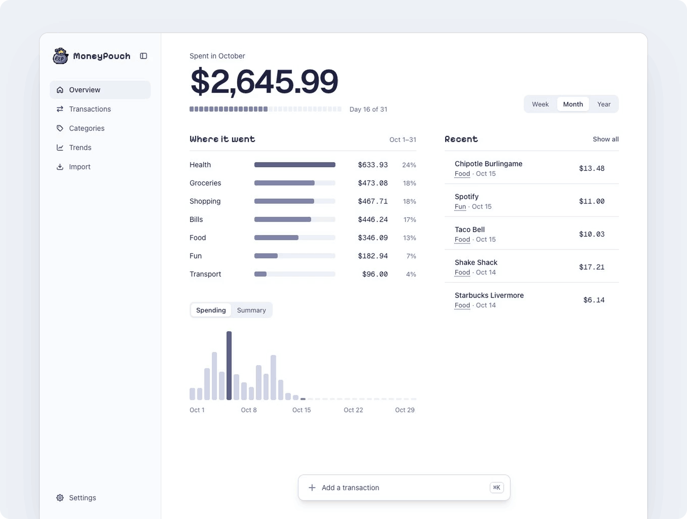
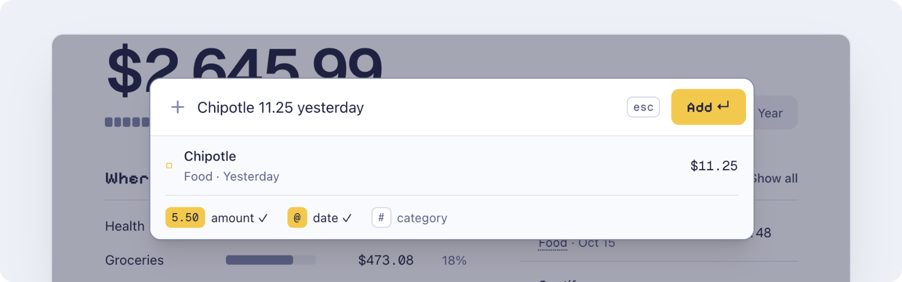

<h1 align="center"><br>MoneyPouch</h1>

<p align="center">No budgets. No net worth. Just see where your money goes.<br>Log an expense in a few seconds, on your own server, for free.</p>

<p align="center">
  <a href="#getting-started">Getting started</a> ·
  <a href="https://github.com/kenyounot123/moneypouch/releases">Releases</a> ·
  <a href="CHANGELOG.md">Changelog</a> ·
  <a href="https://github.com/kenyounot123/moneypouch/issues">Issues</a>
</p>

<p align="center">
  <a href="https://github.com/kenyounot123/moneypouch/releases"></a>
  <a href="https://github.com/kenyounot123/moneypouch/actions/workflows/ci.yml"></a>
  <a href="https://github.com/kenyounot123/moneypouch/pkgs/container/moneypouch"></a>
</p>

<p align="center">
  
</p>

## Features
- **Fast entry.** Press ⌘K (Ctrl+K), type `Chipotle 11.25 yesterday`, and press Enter.
- **It remembers.** Tab completes names you have used, and their category comes back.
- **Your data, your server.** One command starts it. Your data is in SQLite files in a volume you own.
- **Bring your history.** Import an Excel or CSV file. Rows you already have are skipped, and you can undo the whole import.
- **Take it with you.** Download every transaction as a CSV file, any time.
- **Bank sync, optional.** Connect your own SimpleFIN account to pull in transactions from your bank accounts.

## What MoneyPouch is not

MoneyPouch is not a budgeting app. It has no envelopes, no "give every dollar a job", no net worth, and no investment tracking. Those features are good for some people, but most of us only want to know where the money went. MoneyPouch does that one job and stays fast.

## How it compares

| | Price | Budgets | Double-entry | Bank sync | Your server | Adding a purchase |
| :--- | :--- | :--- | :--- | :--- | :--- | :--- |
| **MoneyPouch** | Free | None, tracking only | No | Optional, SimpleFIN | Yes | One line: `Chipotle 11.25 yesterday` |
| [YNAB](https://www.ynab.com) | $109/year | Envelopes | No | Built in | No | A form |
| [Monarch](https://www.monarchmoney.com) | $99.99/year | Category budgets | No | Built in | No | A form |
| [Copilot](https://copilot.money) | $95/year, Apple only | Category budgets | No | Built in | No | A form |
| [Actual Budget](https://actualbudget.org) | Free | Envelopes | No | Optional, SimpleFIN or GoCardless | Yes | A row in the register |
| [Firefly III](https://www.firefly-iii.org) | Free | Optional | Yes | Optional, separate Data Importer | Yes | A form with source and destination accounts |

Prices are for yearly plans as of October 2026. If you want a budget, Actual Budget is a good free choice. If you want real accounting, use Firefly III.

## System requirements

MoneyPouch is light. The image is built for 64-bit x86 and ARM, so an old PC or a Raspberry Pi 4 or later has enough power to run it.

|      | Minimum | Recommended |
| ---- | ------- | ----------- |
| RAM  | 512 MB free | 1 GB free |
| CPU  | Any 64-bit x86 or ARM CPU | 2 cores |
| Disk | 2 GB free | 2 GB free |

Your data takes almost no space. Ten years of spending, 30,000 transactions, is about 5 MB.

These numbers come from running the Docker image with Docker's memory and CPU limits and loading pages as a user with 30,000 transactions. MoneyPouch used about 300 MB of memory and stopped working at a 256 MB limit. With a quarter of one CPU core, pages still loaded in about 0.1 to 0.2 seconds.

## Getting started

MoneyPouch runs in Docker on Windows, macOS, and Linux. You install Docker once, then start MoneyPouch with one command.

### 1. Install Docker

| Your computer | What to install |
| :--- | :--- |
| Windows 10 or 11 | [Docker Desktop for Windows](https://docs.docker.com/desktop/setup/install/windows-install/) |
| macOS | [Docker Desktop for Mac](https://docs.docker.com/desktop/setup/install/mac-install/) |
| Linux, including a Raspberry Pi | [Docker Engine](https://docs.docker.com/engine/install/) |

If you use Docker Desktop, open it and wait until it shows that Docker is running.

### 2. Start MoneyPouch

Open a terminal. On Windows, use PowerShell or Command Prompt. On macOS, use the Terminal app. Paste this command and press Enter:

```bash
docker run -d --name moneypouch --restart unless-stopped -p 8080:80 -v moneypouch-data:/rails/storage ghcr.io/kenyounot123/moneypouch:latest
```

The command is the same in every terminal. The first time, Docker downloads about 250 MB. After that, MoneyPouch is ready in about 2 seconds.

### 3. Open MoneyPouch

Go to [localhost:8080](http://localhost:8080) in your browser and create your account.

MoneyPouch starts again by itself when your computer or Docker restarts. To use a port other than 8080, change the first `8080` in the command. Your data and the app's secret key are in the Docker volume `moneypouch-data`. See [Backups and updates](#backups-and-updates).

### Other ways to install

**ONCE.** Use [ONCE](https://github.com/basecamp/once) on a Linux or macOS server that you want to reach by a domain name. ONCE sets up HTTPS for the domain, backs up your data daily, keeps 30 days of backups, and installs updates.

1. Install ONCE.

   ```bash
   curl https://get.once.com | sh
   ```

2. In the ONCE dashboard, choose to install from a Docker image.
3. Enter the image `ghcr.io/kenyounot123/moneypouch:latest`.
4. Enter a hostname. `moneypouch.localhost` works on this machine only.

**Docker Compose.** Use Compose if you prefer a file, or if your NAS or Portainer asks for one. Save this as `compose.yaml` in an empty folder, and run `docker compose up -d` in that folder. It uses the same container and volume names as the `docker run` command, so every command below works for both.

```yaml
services:
  app:
    image: ghcr.io/kenyounot123/moneypouch:latest
    container_name: moneypouch
    restart: unless-stopped
    ports:
      - "8080:80"
    volumes:
      - moneypouch-data:/rails/storage

volumes:
  moneypouch-data:
    name: moneypouch-data
```

### First steps

1. Create your account.
2. Press ⌘K (Ctrl+K), type `Coffee 4.50`, and press Enter. That's your first expense.
3. Optional: connect your bank in Settings. See [Bank sync with SimpleFIN](#bank-sync-with-simplefin).

## Type it like you'd say it

<p align="center">
  
</p>

| | You type | MoneyPouch reads |
| :--- | :--- | :--- |
| **Amount** | `6.25` `$6.25` `1,650` | this is an expense/spending |
| **Money in** | `+2000` | income, not spending |
| **Date** | `yesterday` `sep 26` `friday` | that day, or today if left out |
| **Category** | `#food` | food, or if left out, the category you last used for that name |

## Bank sync with SimpleFIN

Bank sync is optional but highly recommended. When you turn it on, MoneyPouch reads your transactions through [SimpleFIN](https://www.simplefin.org/), an open protocol for sharing read-only financial data with apps. Here is why you can trust SimpleFIN:

1. **Read-only.** The [protocol](https://www.simplefin.org/protocol.html) has no way to move money. MoneyPouch can see your transactions, and that's all.
2. **Your bank login never reaches MoneyPouch.** You add your bank on the [SimpleFIN Bridge](https://bridge.simplefin.org), not in MoneyPouch. The Bridge hands bank connections to [MX](https://www.mx.com/) and says bank credentials never touch its own servers ([security](https://beta-bridge.simplefin.org/info/security)).
3. **One-time tokens.** You paste a setup token into MoneyPouch, which trades it once for a private access URL. A token that has already been used stops working, so a copied token is useless.
4. **Stored encrypted, on your server.** MoneyPouch encrypts the access URL in your own database. Nothing passes through a MoneyPouch service, because there isn't one.
5. **You can cut it off.** Revoke MoneyPouch's access on the Bridge at any time, or disconnect in MoneyPouch's Settings, which deletes the access URL.
6. **Open about problems.** SimpleFIN publishes its incidents, including an MX bug in May 2026 that briefly showed some users each other's transactions. Bank credentials were not exposed.

The Bridge is a paid service, billed by SimpleFIN directly ([pricing](https://beta-bridge.simplefin.org/)). Read its [privacy policy](https://beta-bridge.simplefin.org/info/privacy) and [terms](https://beta-bridge.simplefin.org/info/terms) before you connect.

## Backups and updates

If you installed with ONCE, it does backups and updates for you. The rest of this section is for the `docker run` and Docker Compose installs. Every command works the same in PowerShell, Command Prompt, and macOS or Linux terminals.

Everything MoneyPouch keeps is in the `moneypouch-data` volume. That includes the secret key that MoneyPouch makes the first time it starts. The key signs the cookie that keeps you signed in, and encrypts your SimpleFIN connection. A backup of the volume holds both your data and the key, so keep your backups private.

### Back up

Stop MoneyPouch, copy its data to a `moneypouch-backup` folder in the current folder, and start it again:

```bash
docker stop moneypouch
docker cp moneypouch:/rails/storage moneypouch-backup
docker start moneypouch
```

Copy the `moneypouch-backup` folder somewhere safe. To make a new backup, first delete or rename the old folder.

### Restore

Run these commands in the folder that holds `moneypouch-backup`.

> [!WARNING]
> The first two commands delete the data MoneyPouch has now. Do them only when you want the backup in its place.

```bash
docker rm -f moneypouch
docker volume rm moneypouch-data
docker create --name moneypouch --restart unless-stopped -p 8080:80 -v moneypouch-data:/rails/storage ghcr.io/kenyounot123/moneypouch:latest
docker cp moneypouch-backup/. moneypouch:/rails/storage
docker run --rm --volumes-from moneypouch -u root --entrypoint chown ghcr.io/kenyounot123/moneypouch:latest -R rails:rails /rails/storage
docker start moneypouch
```

The third command makes a new, empty MoneyPouch without starting it. If you use Docker Compose, run `docker compose create` in your Compose folder instead. The fifth command gives the restored files back to the user that MoneyPouch runs as.

### Update

ONCE installs updates by itself. With `docker run` or Docker Compose, you update by hand. To hear about new versions, open the [MoneyPouch repository](https://github.com/kenyounot123/moneypouch), click **Watch**, choose **Custom**, and select **Releases**. Each release lists what changed.

To update, [back up](#back-up) first. Then get the new image, remove the old container, and start MoneyPouch again with the same command you installed it with. Your data stays in the volume. The next time you open MoneyPouch, it shows what changed in the new version.

```bash
docker pull ghcr.io/kenyounot123/moneypouch:latest
docker rm -f moneypouch
docker run -d --name moneypouch --restart unless-stopped -p 8080:80 -v moneypouch-data:/rails/storage ghcr.io/kenyounot123/moneypouch:latest
```

With Docker Compose, run these two commands in your Compose folder:

```bash
docker compose pull
docker compose up -d
```

If you installed with Docker Compose before version 0.8.0, keep your old `compose.yaml` and `.env` files. They use a different volume name and keep the secret key in `.env`, and they still work.

## Why I built MoneyPouch
I was first using Excel to track my expenses via a simple layout that summed up spending and income based on categories. This was bothersome to set up and the appearance/UI was also ugly (maybe I'm just bad with excel as well). So I looked into other popular finance apps, but most of them want you to budget, and that leads to bloated features that overwhelm someone who just wants to track where their money is going. YNAB makes you give every dollar a job before you spend it. Monarch and Copilot add investment tracking, net worth and bank syncing on top of budgets, and both cost about $100 a year. Rocket Money is built around subscriptions and bill negotiation, and the self-hosted options are either another envelope budgeting tool (Actual Budget) or full double-entry accounting (Firefly III). I didn’t need any of that and I also was not going to pay for something like that. I wanted a fast, good-looking way to log an expense in a few seconds and see where my money goes. So I built MoneyPouch.

## Contributing

Found a bug or have an idea? Open an [issue](https://github.com/kenyounot123/moneypouch/issues). To work on the code, clone the repo and run `bin/setup`.

---

© 2026 MoneyPouch. Free and open source under the [MIT License](LICENSE).
