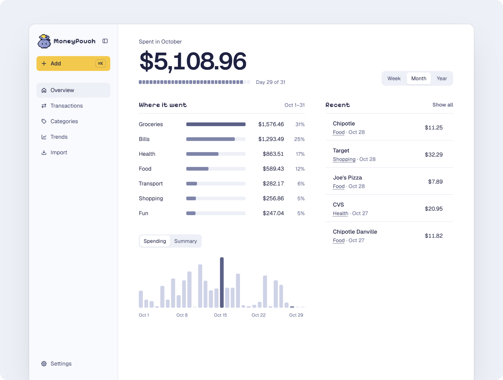

<h1 align="center"><br>MoneyPouch</h1>

<p align="center">A free, self-hosted expense tracker with the fastest manual entry around.</p>

<p align="center">
  <a href="#quickstart">Quickstart</a> ·
  <a href="https://github.com/kenyounot123/moneypouch/releases">Releases</a> ·
  <a href="CHANGELOG.md">Changelog</a> ·
  <a href="https://github.com/kenyounot123/moneypouch/issues">Issues</a>
</p>

<p align="center">
  <a href="https://github.com/kenyounot123/moneypouch/releases"></a>
  <a href="https://github.com/kenyounot123/moneypouch/actions/workflows/ci.yml"></a>
  <a href="https://github.com/kenyounot123/moneypouch/pkgs/container/moneypouch"></a>
</p>

<p align="center">
  
</p>

## Why I built MoneyPouch
I was first using Excel to track my expenses via a simple layout that summed up spending and income based on categories. This was bothersome to set up and the appearance/UI was also ugly (maybe I'm just bad with excel as well). So I looked into other popular finance apps, but most of them want you to budget, and that leads to bloated features that overwhelm someone who just wants to track where their money is going. YNAB makes you give every dollar a job before you spend it. Monarch and Copilot add investment tracking, net worth and bank syncing on top of budgets, and both cost about $100 a year. Rocket Money is built around subscriptions and bill negotiation, and the self-hosted options are either another envelope budgeting tool (Actual Budget) or full double-entry accounting (Firefly III). I didn’t need any of that and I also was not going to pay for something like that. I wanted a fast, good-looking way to log an expense in a few seconds and see where my money goes. So I built MoneyPouch.

## What
- **Fast entry.** Press ⌘K (Ctrl+K), type `Chipotle 11.25 yesterday`, and press Enter.
- **It remembers.** Tab completes names you have used, and their category comes back.
- **Your data, your server.** One container and one SQLite file, in a volume you own.
- **Bank sync, optional.** Connect your own SimpleFIN account to pull in transactions from your bank accounts.

## Type it like you'd say it

<p align="center">
  
</p>

| | You type | MoneyPouch reads |
| :--- | :--- | :--- |
| **Amount** | `6.25` `$6.25` `1,650` | this is an expense/spending |
| **Money in** | `+2000` | income, not spending |
| **Date** | `yesterday` `sep 26` `friday` | that day, or today if left out |
| **Category** | `#food` | food, or if left out, the category you last used for that name |

## Bank sync with SimpleFIN

Bank sync is optional but highly recommended. When you turn it on, MoneyPouch reads your transactions through [SimpleFIN](https://www.simplefin.org/), an open protocol for sharing read-only financial data with apps. Here is why you can trust SimpleFIN:

1. **Read-only.** The [protocol](https://www.simplefin.org/protocol.html) has no way to move money. MoneyPouch can see your transactions, and that's all.
2. **Your bank login never reaches MoneyPouch.** You add your bank on the [SimpleFIN Bridge](https://bridge.simplefin.org), not in MoneyPouch. The Bridge hands bank connections to [MX](https://www.mx.com/) and says bank credentials never touch its own servers ([security](https://beta-bridge.simplefin.org/info/security)).
3. **One-time tokens.** You paste a setup token into MoneyPouch, which trades it once for a private access URL. A token that has already been used stops working, so a copied token is useless.
4. **Stored encrypted, on your server.** MoneyPouch encrypts the access URL in your own database. Nothing passes through a MoneyPouch service, because there isn't one.
5. **You can cut it off.** Revoke MoneyPouch's access on the Bridge at any time, or disconnect in MoneyPouch's Settings, which deletes the access URL.
6. **Open about problems.** SimpleFIN publishes its incidents, including an MX bug in May 2026 that briefly showed some users each other's transactions. Bank credentials were not exposed.

The Bridge is a paid service, billed by SimpleFIN directly ([pricing](https://beta-bridge.simplefin.org/)). Read its [privacy policy](https://beta-bridge.simplefin.org/info/privacy) and [terms](https://beta-bridge.simplefin.org/info/terms) before you connect.

## Quickstart

Run it with Docker Compose in an empty folder.

```bash
curl -O https://raw.githubusercontent.com/kenyounot123/moneypouch/main/compose.yaml
echo "SECRET_KEY_BASE=$(openssl rand -hex 64)" > .env
docker compose up -d
```

Then open `localhost:8080` and create your account.

To upgrade, back up the `moneypouch-data` volume and run `docker compose pull && docker compose up -d`.

## Contributing

Found a bug or have an idea? Open an [issue](https://github.com/kenyounot123/moneypouch/issues). To work on the code, clone the repo and run `bin/setup`.

---

© 2026 MoneyPouch. Free and open source under the [MIT License](LICENSE).
